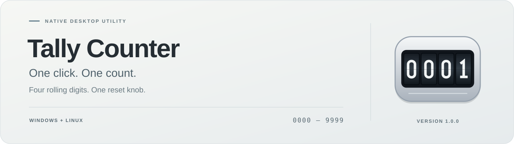
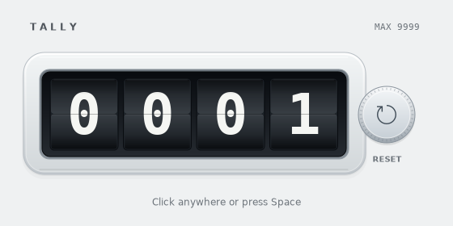
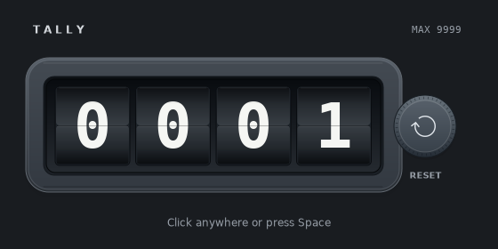

<p align="center">
  <a href="https://github.com/Davoda1/Tally-Counter/releases/tag/v1.0.0"><strong>Download 1.0.0</strong></a>
  &nbsp;·&nbsp;
  <a href="docs/USER-GUIDE.md">User guide</a>
  &nbsp;·&nbsp;
  <a href="docs/BUILDING.md">Build from source</a>
  &nbsp;·&nbsp;
  <a href="CHANGELOG.md">Changelog</a>
</p>

Tally Counter is a small native desktop app with four mechanical digits and one reset knob. Click the counter or press **Space** to add one. Your count is saved automatically, ready for the next time you open it.

| Light appearance | Dark appearance |
| :---: | :---: |
|  |  |

*Actual Linux application captures. The appearance follows your system theme; window decorations depend on your desktop.*

## A counter that stays out of the way

- **0000–9999**, with rolling digits and a firm upper limit.
- **One tally per click or physical Space press.** Holding Space counts once.
- **A mechanical reset.** The knob turns as the digits roll back together; higher counts take longer, up to 2.2 seconds.
- **Quiet click feedback** on successful tallies. Reset and the count limit are silent.
- **Automatic saving** for the count, plus window size, position, and maximized state.
- **Native, offline operation** with light and dark appearances.

## Download

Choose the package for your system from the [1.0.0 release](https://github.com/Davoda1/Tally-Counter/releases/tag/v1.0.0).

| Package | Use it for |
| --- | --- |
| [Windows x64 ZIP](https://github.com/Davoda1/Tally-Counter/releases/download/v1.0.0/Tally-Counter-1.0.0-Windows-x64.zip) | Windows 10 or 11. Extract the archive and open `TallyCounter.exe`. |
| [Linux x64 TAR.GZ](https://github.com/Davoda1/Tally-Counter/releases/download/v1.0.0/Tally-Counter-1.0.0-Linux-x64.tar.gz) | A native executable for manual installation, using your system's GTK 3, Cairo/Pango, and ALSA libraries. |
| [Linux x86_64 AppImage](https://github.com/Davoda1/Tally-Counter/releases/download/v1.0.0/Tally-Counter-1.0.0-x86_64.AppImage) | A single executable package with its GUI libraries bundled. |
| [Debian/Ubuntu amd64 DEB](https://github.com/Davoda1/Tally-Counter/releases/download/v1.0.0/tally-counter_1.0.0_amd64.deb) | Installation through a Debian-compatible package manager, with a desktop-menu entry. |
| [Source TAR.GZ](https://github.com/Davoda1/Tally-Counter/releases/download/v1.0.0/Tally-Counter-1.0.0-Source.tar.gz) | Source, build instructions, tests, license notices, and `SHA256SUMS` for the four binary packages. |

The supplied Linux binaries need **x86-64 and glibc 2.38 or newer**. The TAR.GZ and DEB use system GUI libraries; the AppImage bundles them. See the [installation guide](docs/USER-GUIDE.md#installation) for dependency details, AppImage setup, and checksum verification.

## Use

| Input | Result |
| --- | --- |
| Left-click the digits or surrounding app background | Add one |
| Press Space while the app is focused | Add one |
| Double-click the digits or background | Add two |
| Click the reset knob | Reset to `0000` |
| Press Tab to select Reset, then Enter | Reset to `0000` |

Space always adds one, including when Reset has keyboard focus. At `9999`, the display stays at the limit until you reset. You can start counting again during the reset animation.

The count is saved immediately after a change. Window placement is saved when you close the app. Windows and X11 restore the saved position; Wayland window placement is managed by the compositor. The [user guide](docs/USER-GUIDE.md) explains saved data, themes, and troubleshooting.

## Build

Tally Counter uses C++17, Win32/GDI+ on Windows, and GTK 3/Cairo on Linux. On a Debian-compatible Linux build host:

```sh
sudo apt install build-essential pkg-config libgtk-3-dev
make
./build/tally-counter
```

Run the shared behavioral tests with `make test`. See [Building and packaging](docs/BUILDING.md) for Windows cross-compilation, generated assets, and release packaging.

## Contribute

Bug reports and small, focused improvements are welcome. Read [Contributing](CONTRIBUTING.md) before opening a pull request, or [Security](SECURITY.md) for a security concern.

## License

First-party code, artwork, documentation, and the generated click sound are available under the [zlib License](LICENSE), **Copyright (c) 2026 davoda1**. Distributed third-party components retain their own licenses; see [Third-party notices](THIRD-PARTY-NOTICES.txt) and [`licenses/`](licenses/).
